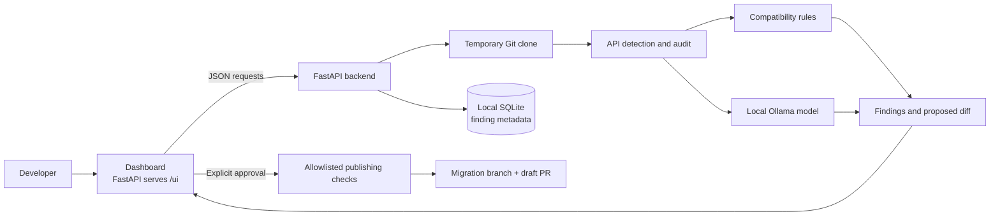

<p align="center">
  
</p>

<h1 align="center">API Guardian</h1>

<p align="center"><strong>Find API compatibility risks. Review a fix. Publish only with approval.</strong></p>

<p align="center">
  API Guardian scans a GitHub repository for API usage, highlights likely compatibility problems,
  and proposes reviewable code changes.
</p>

---

## What it does

- Scans a public GitHub repository on one branch or across its branches.
- Finds common API clients and reads dependency manifests for version context.
- Reports evidence, affected files, severity, and a plain-language recommendation.
- Uses a local Ollama model to help audit API usage and propose fixes.
- Validates Python proposals and shows the exact diff before any publishing step.
- Tracks finding history locally so later scans can show issues as new, open, or resolved.
- Can publish an approved migration branch and open a **draft pull request**. It never merges a PR.

API Guardian is an on-demand developer tool. It does not continuously monitor providers or update repositories in the background.

## How it fits together



The dashboard makes requests to the FastAPI backend. The backend handles repository cloning, analysis, validation, finding history, and optional GitHub publishing. SQLite stores finding lifecycle metadata on the machine running API Guardian; source code and proposed code are not stored in that history database.

## Run locally

### Requirements

- Python **3.13 or 3.14**
- Git
- [Ollama](https://ollama.com/) with the `gemma3:4b` model

### macOS or Linux

Run these commands from the repository root:

```bash
python3.14 -m venv .venv
source .venv/bin/activate
python -m pip install --upgrade pip
python -m pip install -r backend/requirements-dev.txt
ollama pull gemma3:4b
```

If Ollama is not already running, start it in another terminal:

```bash
ollama serve
```

Then start the backend from the repository root:

```bash
cd backend
OLLAMA_MODEL=gemma3:4b python -m uvicorn main:app --reload --host 127.0.0.1 --port 8000
```

Open the dashboard at <http://127.0.0.1:8000/ui>. API docs are at <http://127.0.0.1:8000/docs>, and the health endpoint is <http://127.0.0.1:8000/health>.

For Python 3.13, replace `python3.14` with `python3.13`. In VS Code, open this repository folder, run the setup commands in its integrated terminal, and select `.venv` as the Python interpreter.

### Windows PowerShell

From the repository root:

```powershell
py -3.14 -m venv .venv
.venv\Scripts\Activate.ps1
python -m pip install --upgrade pip
python -m pip install -r backend/requirements-dev.txt
ollama pull gemma3:4b
Set-Location backend
$env:OLLAMA_MODEL = "gemma3:4b"
python -m uvicorn main:app --reload --host 127.0.0.1 --port 8000
```

Then open <http://127.0.0.1:8000/ui>.

## Configuration

The app defaults to Ollama at `http://localhost:11434` and model `gemma3:4b`. You can change them with `OLLAMA_HOST` and `OLLAMA_MODEL` environment variables.

GitHub publishing is optional and disabled until explicitly configured. Copy `backend/.env.example` to `backend/.env`, then set the following only when you want to enable publishing:

```dotenv
GITHUB_TOKEN=your_github_token
API_GUARDIAN_ALLOWED_REPOSITORIES=owner/repository
API_GUARDIAN_ENABLE_PUBLISH=true
```

Use a token with access to the allowlisted repository and permission to push branches and create pull requests. Keep `backend/.env` private; never commit or share the token. After changing configuration, restart the backend. Every publish review is tied to the exact diff and base commit and expires; the user must review the diff, check the approval box, and approve the draft PR action.

## Review workflow

1. **Scan** — enter a GitHub repository URL, optionally add API release notes, and select a branch or all branches.
2. **Understand** — review detected API usage, evidence, issue severity, and recommendations.
3. **Repair** — request a fix when offered, then inspect its validation status and exact diff.
4. **Approve** — optionally publish the reviewed changes as a migration branch and draft PR.

A scan does not write to GitHub. Publishing does not merge the pull request.

## Scope and limitations

- Detection covers a growing set of API clients and source types; it is not a complete semantic analyzer.
- The current automatic repair path generates **Python** fixes. Findings in other languages can still be reported, but may need a manual change.
- The backend validates proposed edits and rechecks supported rules, but does not run the target repository's full test suite. Run the repository's own checks before merging.
- Ollama output can be wrong. Treat findings and patches as suggestions and review the evidence and diff.
- Scan history is local to this installation and stores finding metadata, not source snippets or proposed source code.

## Development checks

From the repository root, with the virtual environment active:

```bash
python -m pytest -q
```

The default pytest configuration excludes tests that require a live Ollama service or external GitHub access.

## Project documentation

See [Project documentation](docs/PROJECT_DOCUMENTATION.md) for the problem framing, architecture, challenges, accomplishments, and next steps. See [Backend guide](backend/README.md) for backend routes and configuration details.

DVC and MLflow are not required to run the application. The optional offline evaluation materials are documented in [README_MEMBER3.md](README_MEMBER3.md).
