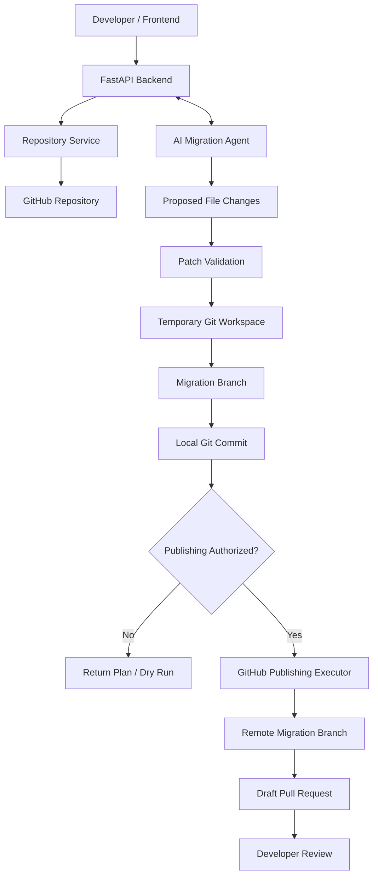
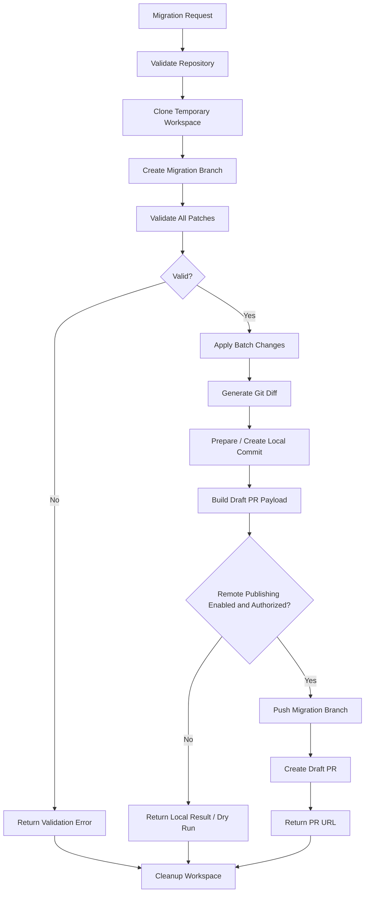
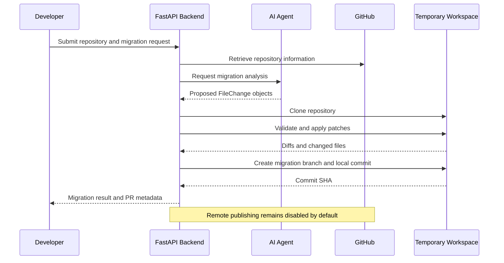

# API Guardian — Backend & GitHub Integration

**Self-Maintaining API Discovery and Migration Assistant**

API Guardian accepts a GitHub repository link, discovers API clients and dependency versions, audits source call sites for likely compatibility issues, and proposes reviewable fixes. A changelog is optional for targeted migration analysis.

This directory contains the **FastAPI backend and GitHub integration layer**, developed as Member 2's responsibility.

---

## 1. Overview

Third-party APIs frequently introduce breaking changes, deprecate methods, or modify request and response formats. Developers must manually inspect changelogs, locate affected code, update implementations, and submit fixes.

API Guardian aims to automate this process:

1. Identify API clients and dependency versions in a repository.
2. Analyze source call sites for likely compatibility issues.
3. Generate evidence-backed findings and proposed code modifications.
4. Validate the proposed modifications.
5. Preview and apply changes in an isolated workspace.
6. Create a dedicated Git migration branch.
7. Prepare or create a Git commit.
8. Generate a draft GitHub pull request for developer review.

The backend coordinates the repository operations and exposes the workflow through REST APIs.

**Current status:** Repository analysis, patch validation, migration planning, local commits, and publishing dry runs are implemented. Remote GitHub publishing code is under development/testing and must not be enabled without explicit authorization.

---

## 2. Technology Stack

| Technology | Purpose |
|---|---|
| Python 3.10+ | Backend implementation |
| FastAPI | REST API framework |
| Pydantic | Request and response validation |
| GitPython | Repository cloning, branching, diffing, and commits |
| HTTPX | Asynchronous GitHub REST API requests |
| GitHub REST API | Repository metadata, permissions, and draft pull requests |
| python-dotenv | Local environment configuration |
| Uvicorn | ASGI development server |
| Git | Version control and migration history |

---

## 3. System Architecture

API Guardian consists of three primary components:

- **AI Agent (Member 1):** Detects API changes, scans relevant source code, and proposes migration patches.
- **Backend & GitHub Integration (Member 2):** Validates proposed changes, manages isolated repositories, generates commits, and integrates with GitHub.
- **MLOps & Evaluation (Member 3):** Evaluates migration quality, manages datasets, and tracks experiments and performance.

### Architecture diagram



The AI agent proposes changes, but the backend remains responsible for validating and applying them.

---

## 4. Backend Project Structure

```text
backend/
├── main.py
├── requirements.txt
├── .env
├── README.md
│
├── models/
│   ├── __init__.py
│   └── schemas.py
│
├── routes/
│   ├── __init__.py
│   ├── repositories.py
│   ├── workspaces.py
│   └── migrations.py
│
├── services/
│   ├── __init__.py
│   ├── github_service.py
│   ├── github_auth_service.py
│   ├── github_permissions_service.py
│   ├── github_access_service.py
│   ├── repository_service.py
│   ├── agent_service.py
│   ├── patch_service.py
│   ├── batch_patch_service.py
│   ├── migration_service.py
│   ├── git_branch_service.py
│   ├── git_commit_service.py
│   ├── pull_request_service.py
│   ├── github_publish_service.py
│   └── github_publish_executor.py
│
├── test_patch_service.py
├── test_batch_patch.py
├── test_git_branch.py
├── test_git_commit.py
├── test_local_commit.py
├── test_github_permissions.py
├── test_github_access.py
├── test_pull_request.py
├── test_github_publish.py
└── test_publishing_integration.py
```

### Directory responsibilities

**`models/`** contains Pydantic models defining request and response contracts.

**`routes/`** exposes HTTP endpoints and converts service errors into HTTP responses.

**`services/`** contains the business logic for GitHub communication, repository operations, patch validation, migration orchestration, and Git operations.

**Test files** validate individual components and integration workflows.

---

## 5. Complete Migration Workflow

### Step 1 — Receive a migration request

The backend receives a target GitHub repository and proposed source-code changes.

A migration request includes:

- Repository owner and name
- Migration summary
- Target base branch
- Proposed commit message
- A list of affected files
- Original and replacement code snippets
- Explanation of each proposed modification

Example:

```json
{
  "owner": "sneha0832",
  "repo": "api-guardian-test-repo",
  "summary": "Replace deprecated payment API calls.",
  "base_branch": "main",
  "commit_message": "fix: migrate deprecated payment API",
  "changes": [
    {
      "file_path": "api_client.py",
      "original_code": "client.old_charge(100)",
      "updated_code": "client.new_charge(100)",
      "explanation": "Replace the deprecated payment method."
    }
  ]
}
```

### Step 2 — Retrieve repository information

The GitHub integration service retrieves repository metadata using the GitHub REST API.

This includes repository identity, visibility, default branch, and available permission information.

Repository access is checked before attempting operations that require authentication.

### Step 3 — Clone into a temporary workspace

The repository service clones the GitHub repository into an isolated temporary directory.

This prevents migration experiments from modifying the developer's existing working directory.

Temporary workspaces are cleaned up after processing, including when an operation fails.

### Step 4 — Validate proposed changes

The patch validation service checks that:

- Target paths are relative and remain inside the repository.
- Target files exist and are regular files.
- Symbolic links cannot escape the repository.
- The original code snippet exists exactly once in its target file.
- Duplicate modifications to the same file are rejected by batch preparation.
- All patches can be prepared before batch application begins.

If validation fails, the backend returns an error rather than knowingly applying an invalid migration.

### Step 5 — Generate a patch preview

The backend generates a unified Git-style diff.

Example:

```diff
- result = client.old_charge(100)
+ result = client.new_charge(100)
```

Developers can inspect the proposed modifications before committing them.

### Step 6 — Apply patches

Validated changes are applied to the temporary repository.

Batch processing prepares all changes before writing them and attempts to restore previously modified files if a write fails.

This provides protection against partial application, although it is not a transactional filesystem guarantee.

### Step 7 — Create a migration branch

The Git branch service creates a uniquely named local branch.

Example:

```text
api-guardian/migration-d64d0d75eee7
```

Migration changes are isolated from the repository's original branch.

### Step 8 — Create a local Git commit

The commit service stages validated files and creates a commit on the temporary migration branch.

It verifies:

- The active branch uses the expected migration naming convention.
- The staging area does not contain unrelated staged changes.
- Only validated files are selected for the commit.
- The resulting commit contains the expected files.

Example commit message:

```text
fix: replace deprecated payment API calls
```

The service returns the commit SHA and committed file list.

### Step 9 — Prepare GitHub publishing

The publishing planner prepares the intended operations:

1. Create a migration commit.
2. Push the migration branch.
3. Open a draft pull request.

The dry-run response describes these operations without executing remote writes.

### Step 10 — Publish and create a draft PR

The publishing executor contains functionality intended to push a migration branch and create a draft pull request through GitHub.

**This is a guarded, not-yet-production-ready capability.** Publishing requires additional authentication and authorization controls, explicit approval, and successful integration testing.

When publishing is disabled, the workflow stops at the local commit or dry-run stage.

### Migration lifecycle diagram



---

## 6. REST API Reference

Base URL for local development:

`http://127.0.0.1:8000`

Interactive documentation:

`http://127.0.0.1:8000/docs`

| Method | Endpoint | Description |
|---|---|---|
| GET | `/` | Backend information |
| GET | `/health` | Health check |
| GET | `/api/repositories/{owner}/{repo}` | Retrieve GitHub repository metadata |
| POST | `/api/workspaces/scan/{owner}/{repo}` | Clone and inspect repository source files |
| POST | `/api/migrations/analyze` | Request migration analysis |
| POST | `/api/migrations/preview` | Validate patches and generate diffs |
| POST | `/api/migrations/apply` | Apply patches in a temporary clone |
| POST | `/api/migrations/prepare` | Create a local migration branch and apply changes |
| POST | `/api/migrations/prepare-pr` | Prepare draft pull-request metadata |
| POST | `/api/migrations/plan` | Generate a complete migration plan |
| POST | `/api/migrations/publish/dry-run` | Preview GitHub publishing operations |
| POST | `/api/migrations/commit/local` | Create a temporary local migration commit |
| GET | `/api/mlops/status` | Check local MLflow and DVC availability |
| GET | `/api/mlops/runs` | List recent MLflow runs |
| POST | `/api/mlops/dvc/repro` | Reproduce the DVC fixture-baseline evaluation |

The publishing executor is currently a service function and is **not exposed as a public publishing endpoint**.

### Example: Analyze a repository with the local agent

Send a repository URL to `POST /api/migrations/analyze`:

```json
{
  "repo_url": "https://github.com/example-owner/example-repository",
  "all_branches": true
}
```

The endpoint clones the public repository into a temporary workspace, detects supported API client calls, reads common dependency manifests, and asks Ollama to audit detected call sites for concrete compatibility risks. Results include API evidence, dependency versions when available, findings, and optional proposed code. It scans every supported source file on every fetched branch by default. Set `all_branches` to `false` and provide `branch` to scan one named branch. A `changelog` can still be supplied for a targeted migration check. The scan proposes changes only; it does not write to GitHub. Full scans can take a long time and use substantial local model resources on large repositories.

### Example: Migration plan

**Request**

`POST /api/migrations/plan`

**Response (abbreviated)**

```json
{
  "repository": "sneha0832/api-guardian-test-repo",
  "branch_name": "api-guardian/migration-example123",
  "changed_files": [
    "api_client.py",
    "checkout.py"
  ],
  "total_changed_files": 2,
  "diff": "diff --git ...",
  "commit_plan": {
    "commit_message": "fix: replace deprecated payment API calls",
    "status": "commit_plan_prepared"
  },
  "pull_request": {
    "title": "fix: migrate deprecated API usage",
    "head": "api-guardian/migration-example123",
    "base": "main",
    "draft": true
  },
  "status": "migration_plan_prepared"
}
```

### Example: Publishing dry run

**Request**

`POST /api/migrations/publish/dry-run`

**Response (abbreviated)**

```json
{
  "repository": "sneha0832/api-guardian-test-repo",
  "operations": [
    {
      "step": 1,
      "action": "create_local_commit"
    },
    {
      "step": 2,
      "action": "push_migration_branch"
    },
    {
      "step": 3,
      "action": "create_draft_pull_request"
    }
  ],
  "remote_writes_enabled": false,
  "status": "dry_run_only"
}
```

---

## 7. GitHub Integration

### Authentication

GitHub authentication uses a personal access token supplied through environment configuration.

Example `backend/.env`:

```env
GITHUB_TOKEN=your_github_token_here
```

Never commit this file to Git.

The repository `.gitignore` should include:

```gitignore
.env
.env.*
.venv/
__pycache__/
```

### Repository permissions

The backend can inspect GitHub repository permission metadata to help determine whether an authenticated user may read or push to a repository.

Repository permission metadata alone does not prove that a token has every permission needed for a write operation.

### Publishing restrictions

The publishing service only writes to repositories explicitly named in
`API_GUARDIAN_ALLOWED_REPOSITORIES`. The development default remains the
test repository:

```text
sneha0832/api-guardian-test-repo
```

For a repository you own, add its exact `owner/repository` name to
`backend/.env` as a comma-separated allowlist. For example:

```env
GITHUB_TOKEN=your_fine_grained_token
API_GUARDIAN_ALLOWED_REPOSITORIES=sneha0832/notion-task-manager-test
API_GUARDIAN_ENABLE_PUBLISH=true
```

Use a fine-grained token scoped only to that repository with **Contents: Read
and write** and **Pull requests: Read and write**. Never commit `.env`. Restart
the backend after changing it.

### Review and publish workflow

1. Audit a repository and select **Generate safe fix** (or **Review proposed
   fix** when the scan already produced code).
2. Inspect the candidate edit, then choose **Prepare exact GitHub review**.
   API Guardian clones the selected base branch and shows the authoritative
   unified diff. Preparing a review makes no remote changes.
3. Check the approval box and choose **Approve & publish draft PR**. API
   Guardian re-clones the base branch and verifies its commit and resulting
   diff still match the review before it creates a migration branch and draft
   pull request. It never merges the PR.

Reviews expire after 15 minutes, are single-use, and are held in memory by the
backend. If the base branch changes, prepare and inspect a new review. The
dashboard reports which server settings are missing without exposing the
token. Publishing remains disabled unless the target is allowlisted, a token
is configured, and `API_GUARDIAN_ENABLE_PUBLISH=true`.

The current AI fix generator supports Python source files. If it cannot
produce a unique, syntactically valid edit, it reports that it could not
generate a safe patch and does not offer that change for publishing.

### Remote publishing safety

Remote writes should remain disabled until the following conditions are met:

- The user explicitly approves the destination and publishing action.
- The GitHub token has only the necessary permissions.
- The publishing workflow has been tested against the approved test repository.
- Authorization is enforced on the server, not merely through a client-supplied flag.
- Credentials are handled securely without exposure through logs or process arguments.
- The system has appropriate protections against unintended or duplicate publishing.

---

## 8. AI Agent Integration

The backend is designed to accept migration recommendations produced by Member 1's AI agent.

The current integration boundary uses a structured `FileChange` object.

```json
{
  "file_path": "checkout.py",
  "original_code": "client.old_charge(amount)",
  "updated_code": "client.new_charge(amount)",
  "explanation": "Replace deprecated API usage."
}
```

### Integration workflow



**Integration status:** `POST /api/migrations/analyze` discovers supported API client calls and dependency versions, audits candidate call sites, and proposes changes without applying them. Configure the model and Ollama host with `OLLAMA_MODEL` and `OLLAMA_HOST`. Automatic findings are model-generated review suggestions; verify them before use.

---

## 9. Local Development Setup

### Prerequisites

- Python 3.10 or later
- Git installed and available in `PATH`
- Ollama installed and running, with `gemma3:4b` available by default
- A GitHub account
- A GitHub personal access token for authenticated GitHub operations

### Clone the project

```bash
git clone https://github.com/DevanshuSurana/API-Guardian.git
cd API-Guardian
```

### Create and activate a virtual environment

From the project root:

```bash
python3 -m venv .venv
source .venv/bin/activate
```

On Windows:

```powershell
.venv\Scripts\activate
```

### Install dependencies

```bash
cd backend
python -m pip install -r requirements.txt
python -m pip install -r requirements-dev.txt
```

### Configure environment variables

Create `backend/.env` and add your GitHub token.

Keep publishing disabled:

```env
GITHUB_TOKEN=your_github_token_here
API_GUARDIAN_ENABLE_PUBLISH=false
```

Set the local Ollama model and host in the shell before starting the backend.

macOS/Linux:

```bash
export OLLAMA_MODEL=gemma3:4b
export OLLAMA_HOST=http://localhost:11434
```

Windows PowerShell:

```powershell
$env:OLLAMA_MODEL="gemma3:4b"
$env:OLLAMA_HOST="http://localhost:11434"
```

### Start the API server

```bash
python -m uvicorn main:app --reload
```

Open:

- API root: http://127.0.0.1:8000/
- Interactive dashboard: http://127.0.0.1:8000/ui
- Health check: http://127.0.0.1:8000/health
- Swagger UI: http://127.0.0.1:8000/docs

### Interactive dashboard, MLflow, and DVC

The dashboard at `/ui` submits repository scans to the backend, displays proposed diffs, and shows recent MLflow runs. Successful scans log the repository, model, timing, detection result, and affected file paths; source code is not logged to MLflow.

Install both backend and MLOps dependencies from the `backend/` directory:

```bash
python -m pip install -r requirements-dev.txt
```

The development requirements include `../requirements-mlops.txt`, which installs MLflow and DVC. In the dashboard, **Run DVC baseline** runs the `evaluate` stage in the root `dvc.yaml`, then records its report in the `api-guardian-dvc-evaluation` MLflow experiment. This stage uses fixture predictions as a pipeline smoke test; its scores are not live-agent performance.

The default MLflow tracking store is the local root-level `mlflow.db`. To inspect runs in the MLflow UI, open another terminal at the project root, activate `backend/.venv`, then run:

```bash
mlflow ui --backend-store-uri sqlite:///mlflow.db --host 127.0.0.1 --port 5000
```

Open http://127.0.0.1:5000 to inspect the experiments.

---

## 10. Testing

The default test suite is offline and skips tests marked `integration`.

Run the unit tests from the `backend` directory:

```bash
python -m pytest -q
```

AI and GitHub integration tests are opt-in because they call Ollama or clone a public GitHub repository. With Ollama running and `OLLAMA_MODEL` set, run the AI repair integration with:

```bash
python -m pytest -o addopts= -m integration tests/test_ai_repository_repair.py
```

Two repository-clone tests also require network access:

```bash
python -m pytest -o addopts= -m integration tests/test_git_commit.py tests/test_local_commit.py
```

### Test coverage areas

| Component | What is tested |
|---|---|
| Patch validation | Valid and invalid source replacements |
| Batch patching | Multiple changes and rejection of invalid batches |
| Git branching | Creation of dedicated migration branches |
| Git diff | Detection of modified source files |
| Commit planning | Preparation of commit metadata |
| Local commits | Real commit creation in temporary clones |
| GitHub permissions | Read, push, and admin permission interpretation |
| Repository access | Authenticated repository metadata retrieval |
| PR payloads | Draft PR structure and input validation |
| Publishing dry run | Publishing operation planning without remote writes |
| Integration | Migration planning and unauthorized publishing rejection |

Some tests use local temporary repositories, while others access the public GitHub test repository.

### Test repository

The dedicated test repository is:

https://github.com/sneha0832/api-guardian-test-repo

It includes simulated deprecated payment API calls for verifying the migration pipeline.

Example migration:

```python
client.old_charge(100)
```

becomes:

```python
client.new_charge(100)
```

This allows the backend to demonstrate a complete migration without modifying production applications.

---

## 11. Error Handling

The backend distinguishes several common failure types.

| Error | Expected behavior |
|---|---|
| Invalid repository identifier | Reject the request |
| Missing source file | Reject patch validation |
| Path traversal attempt | Reject unsafe file path |
| Original snippet not found | Reject the patch |
| Ambiguous multiple snippet matches | Reject the patch |
| Duplicate target file in batch | Reject the batch |
| Git clone or branch failure | Report Git operation failure |
| Missing GitHub credentials | Report authentication configuration error |
| Unauthorized publishing | Block remote operations |
| Unapproved repository | Reject publishing |
| GitHub API failure | Return or report an appropriate error |

Temporary workspaces are cleaned up through `finally` blocks, reducing the risk of abandoned cloned repositories.

---

## 12. Security Considerations

API Guardian processes externally supplied repository contents and AI-generated code changes, so validation is essential.

Current safeguards include:

- Relative-path validation for patch targets.
- Protection against patching files outside the cloned repository.
- Rejection of ambiguous replacements.
- Batch preparation before modifications.
- Restricted migration branch naming.
- Repository allowlisting for publishing operations.
- Local commits restricted to validated file selections.
- Remote publishing disabled by default.
- Temporary workspace cleanup.

### Production hardening still needed

Before deploying API Guardian as a public service, additional safeguards are required:

- Server-side user authentication and per-repository authorization.
- Secure secret storage and short-lived credentials where possible.
- GitHub App authentication instead of relying solely on personal access tokens.
- Limits on repository size, clone time, and resource consumption.
- Sandboxed execution of any repository tests or generated code.
- Stronger validation of source branch and repository identity.
- Protection against credential leakage in Git commands and logs.
- Rate limiting, audit logs, and structured error responses.
- Handling of partial publishing failures, such as a pushed branch followed by a failed PR request.

Generated patches must be reviewed and tested before merging.

---

## 13. Current Implementation Status

| Feature | Status |
|---|---|
| FastAPI backend | Implemented |
| GitHub repository metadata | Implemented |
| GitHub authentication checks | Implemented |
| Repository permission checks | Implemented |
| Repository cloning | Implemented |
| Source-file discovery | Implemented |
| Migration request schemas | Implemented |
| AI agent adapter | Local Ollama integration for repository analysis |
| Patch validation | Implemented |
| Patch preview | Implemented |
| Batch patch application | Implemented |
| Local migration branches | Implemented |
| Git diff generation | Implemented |
| Commit planning | Implemented |
| Local Git commits | Implemented and tested |
| Draft PR payload generation | Implemented |
| Publishing dry run | Implemented and tested |
| Remote branch publishing | Executor implemented; authorization and testing pending |
| Draft PR creation | Executor implemented; authorization and testing pending |
| Repository analysis with local Ollama | Implemented; returns proposed changes without applying them |
| End-to-end AI-to-GitHub publishing | Pending; publishing remains gated and requires integration tests |

---

## 14. Future Improvements

Potential improvements include:

1. Run repository tests against each generated patch before preparing a PR.
2. Add a persistent migration job model and job-status endpoints.
3. Support background processing for large repositories.
4. Add GitHub webhook support for relevant repository events.
5. Track migration history, success rates, latency, and failure reasons.
6. Support multiple repositories and API providers with scoped authorization.
7. Add human approval checkpoints before remote publishing.
8. Improve rollback and recovery for partial publishing failures.
9. Integrate Member 3's evaluation metrics into migration reports.

---

## 15. Team Responsibilities

### Member 1 — AI Agent

Responsible for changelog interpretation, breaking-change detection, source-code analysis, and migration patch generation.

### Member 2 — Backend & GitHub Integration

Responsible for:

- FastAPI endpoints and schemas
- GitHub authentication and repository metadata
- Repository cloning and workspace management
- Patch validation and application
- Git branching, diffing, and local commits
- Draft pull-request payload generation
- Publishing integration and safety controls
- Backend testing and documentation

### Member 3 — MLOps & Evaluation

Responsible for datasets, experiment tracking, migration evaluation, benchmarks, and model quality reporting.

---

## 16. Summary

API Guardian's backend provides the infrastructure for turning proposed API migration changes into validated, reviewable Git modifications.

The current implementation supports the complete local workflow from repository cloning to verified Git commits, with publishing plans and draft PR metadata prepared for later use.

The next major milestone is to validate proposed patches with the target repository's own tests and connect Member 3's evaluation reports to real agent runs. GitHub publishing remains gated and requires separate integration testing and explicit approval.

**The goal is not to merge AI-generated code automatically, but to reduce repetitive migration work while keeping developers in control of the final changes.**
