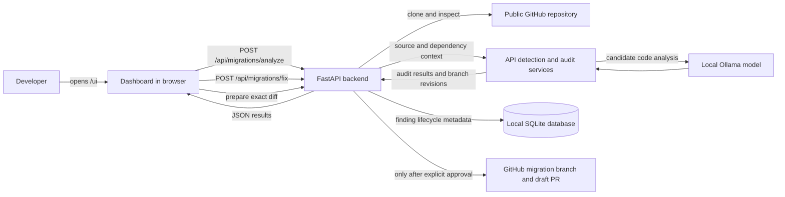

# API Guardian — Project Documentation

## Problem framing

### 1. What problem are we trying to solve, and who does it affect?

External APIs change over time. Providers may remove an endpoint, rename a parameter, change a request format, or deprecate a library method. When that happens, application code can stop working even though the repository still builds or the break only appears at runtime.

Developers and maintainers are affected most. They have to find every use of the API, understand the change, update the code, check that the update is safe, and prepare a change for review. Repositories with many files or branches make that work slower and easier to miss.

### 2. What is the idea?

API Guardian takes a GitHub repository link and audits the code for supported API clients and likely compatibility risks. It can also use API release notes or a changelog supplied by the user to focus the audit. It reports the affected file, evidence, severity, and a recommended fix. When it can create a safe code proposal, it displays the diff for review.

The developer remains in control: scanning does not write to GitHub. Publishing is a separate, optional step that requires the developer to review and approve the exact diff. API Guardian opens a **draft pull request**; it does not merge changes.

## Implementation

### How the pieces fit together

The frontend is the interactive dashboard served by FastAPI at `/ui`. Its JavaScript sends HTTP requests to the same FastAPI backend. The backend coordinates repository access, source scanning, the local language model, validation, finding history, and optional GitHub publishing.

### Scan and repair flow

1. The user enters a GitHub repository URL, optionally adds release notes, and chooses one branch or all branches.
2. The dashboard sends a JSON request to `POST /api/migrations/analyze`.
3. FastAPI validates the repository address and asks the repository service to clone it into a temporary workspace. The workspace is removed after the scan.
4. The backend checks supported source files and dependency manifests. Detection rules identify known API clients and call sites; the audit agent uses the source and dependency context to assess likely compatibility issues. The default local model is `gemma3:4b` through Ollama.
5. The backend returns API usage, findings, severity, evidence, recommendations, any safe proposed file changes, scanned branches, and commit revisions. The dashboard displays them in expandable issue cards.
6. A user can request a targeted repair with `POST /api/migrations/fix`. The backend validates Python edits with syntax and available static checks, then rechecks the finding where a detector supports it. It displays the diff for review; it does not run the target repository's full test suite. A finding that cannot be safely changed remains a recommendation for manual review.
7. To publish, the dashboard first calls `POST /api/migrations/publish/prepare`. This prepares an expiring review tied to the exact diff and scanned base commit; it does not push anything. Only after the user checks the approval box and calls `POST /api/migrations/publish/approve` can the backend push an allowed migration branch and create a draft pull request.

### Where the database fits

The app uses a local SQLite file, `scan-history.db`, for finding history. The backend assigns each finding a stable fingerprint based on the repository, branch, file, and issue title. It records lifecycle metadata such as when the finding was first and last seen, the scanned commit, and whether a later complete scan resolved it.

The browser never connects to this database directly; only the backend reads and writes it. This database is separate from the scanned repository and from the AI repair workflow. It stores finding metadata, not source snippets, evidence text, or proposed source code. It helps the dashboard distinguish new, continuing, and resolved issues across scans. A changelog-focused scan does not resolve findings it did not inspect; resolution is recorded only after a complete scan of the relevant branch or branches.

The database is local to the running installation. It is not a shared cloud database, and the repository is cloned into a temporary workspace rather than stored in SQLite.

### GitHub access and safety

- Repository analysis uses a temporary clone and does not write to GitHub.
- Publishing is disabled by default. Enabling it requires a GitHub token, an explicit repository allowlist, and `API_GUARDIAN_ENABLE_PUBLISH=true` in the backend environment.
- Each publish review is tied to the exact diff and base commit and expires after a short period. If the base branch changes, the review must be prepared again.
- The publish step creates a migration branch and draft pull request only after explicit approval. The project does not merge the pull request.

### Current scope and limitations

- API detection supports a growing set of common clients and source file types, but it is not a complete semantic analyzer for every language or SDK.
- The current code repair agent generates Python fixes only. Findings in other languages can still be reported with evidence and recommendations, but require a manual fix.
- Users can provide release notes for a targeted audit. The current app does not continuously monitor API providers or automatically subscribe to new releases.
- The local model can make mistakes. Findings and proposed fixes are suggestions; review the evidence and diff before publishing.
- Automated code checks do not replace the target repository's own tests. A proposed patch should be validated with that repository's tests and reviewed by its maintainers.
- SQLite history is local to one installation. A team deployment would need shared storage and appropriate access controls.

## Challenges

- **Finding real API calls without flagging local code:** Generic HTTP and browser `fetch` calls can target an application's own backend. API Guardian uses source evidence and filters ambiguous local calls so it is less likely to report them as third-party API usage.
- **Avoiding repeat and stale findings:** The same issue can appear in repeated scans, while a finding on one branch should not be treated as resolved on another. Branch-scoped fingerprints and complete-scan reconciliation preserve that distinction.
- **Making model-generated edits safe to review:** A plausible explanation is not enough. The backend checks whether a proposed edit applies to the expected source and runs available validation and recheck steps. If a safe edit cannot be confirmed, it presents the recommendation without silently changing the repository.
- **Keeping GitHub writes deliberate:** A scan or generated patch must not publish on its own. Publishing is isolated behind repository allowlisting, server configuration, an exact-diff review, and explicit approval.
- **Handling larger, multi-branch repositories:** The user can scan one branch or request every branch. The backend records the scanned commit per branch so later comparisons are made against the right revision.

## Accomplishments

- Built a browser dashboard for scanning a GitHub repository and reviewing findings, proposed changes, and diffs.
- Connected the dashboard to a FastAPI backend through JSON API requests.
- Added API client and dependency-manifest detection, branch selection, and branch-aware scan results.
- Integrated a local Ollama model for code audits and targeted repair proposals.
- Added validation and recheck steps so unsupported or unsafe proposals can be withheld from publishing.
- Added local SQLite finding history to track issues across scans and identify resolutions.
- Added a guarded GitHub workflow that can publish an approved migration branch and open a draft pull request.
- Kept DVC and MLflow out of the app's required scan and repair workflow; the application can run without them.

## Next steps

1. **Evaluate scan quality:** Build a labeled set of real API changes and repositories, then measure false positives, missed issues, and fix success.
2. **Add release monitoring:** Connect trusted provider changelogs or API specifications and offer scheduled audits when those sources change.
3. **Expand language and SDK coverage:** Add provider-specific rules and stronger parsers for more languages, clients, and dependency formats.
4. **Validate fixes against repository tests:** Run relevant checks in an isolated environment and include the results with the proposed diff.
5. **Prepare for team use:** Add shared persistent storage, user authentication, deployment configuration, and operational logging before hosting it for multiple users.
6. **Improve the submission demo:** Use a small public test repository with a known API issue, show the finding and proposed diff, then demonstrate the approval-gated draft PR flow.
